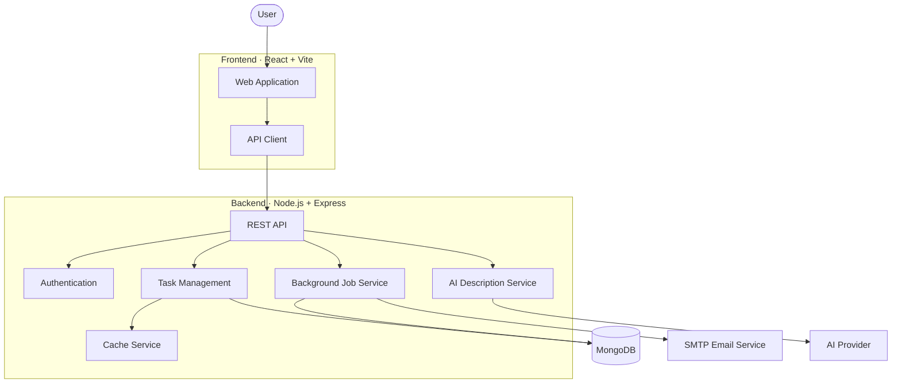
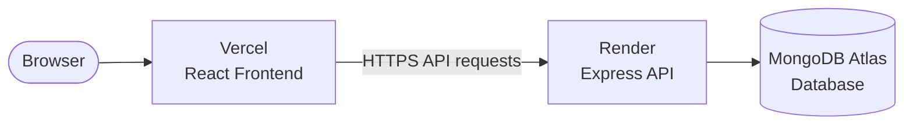

 <div align="center">

# AWDF

### Advanced Web Development Framework

**A full-stack task management application built with React, Express, and MongoDB.**

Manage tasks, explore secure authentication, background jobs, caching, and AI-powered task description generation.

<br/>

<a href="https://awdf-sooty.vercel.app/"><strong>🌐 Live Demo</strong></a>
&nbsp; • &nbsp;
<a href="https://github.com/HARSHIL3431/AWDF"><strong>📂 GitHub Repository</strong></a>

<br/><br/>


</div>

---

## ✨ About the Project

AWDF is a full-stack task management system developed as part of academic practical work in web development.

The project brings together a modern frontend, REST API, database persistence, authentication, performance optimization, background processing, and AI integration in one application.

<div align="center">

| 📝 Task Management | 🔐 Authentication | ⚡ Performance | 🤖 AI Integration |
|:---:|:---:|:---:|:---:|
| Create and manage tasks | JWT-based authentication | In-memory caching | AI-generated descriptions |
| CRUD operations | Password reset workflow | Cache invalidation | LLM provider integration |

</div>

## 🚀 Live Deployment

<div align="center">

| Component | Technology | Status |
|:---|:---|:---|
| Frontend | Vercel | 🌐 [Open Website](https://awdf-sooty.vercel.app/) |
| Backend API | Render | Node.js / Express |
| Database | MongoDB Atlas | Cloud Database |

</div>

## 🖥️ Application Preview

> Add screenshots of your deployed application here to give visitors an immediate visual preview.

<div align="center">

<!-- Replace these placeholders with screenshots from your application -->


<sub>AWDF application dashboard</sub>

</div>

## 🧩 Core Features

<div align="center">

<table>
<tr>
<td width="50%" valign="top">

### 📋 Task Management

- Create and manage tasks
- Update task information
- View task collections
- Delete tasks
- Persistent database storage

</td>
<td width="50%" valign="top">

### 🔒 Secure Authentication

- User registration and login
- JWT-based authentication
- Protected API endpoints
- Password hashing
- Password reset workflow

</td>
</tr>
<tr>
<td width="50%" valign="top">

### ⚡ Performance

- In-memory caching
- Cache invalidation
- Cache statistics
- Reduced repeated database queries

</td>
<td width="50%" valign="top">

### 🤖 AI Task Assistant

- Generate task descriptions
- Support for configured AI providers
- Editable generated descriptions
- Backend-managed API credentials

</td>
</tr>
<tr>
<td width="50%" valign="top">

### 🔄 Background Processing

- MongoDB-backed job queue
- Asynchronous email processing
- Retry handling
- Dead-letter handling
- Encrypted job payloads

</td>
<td width="50%" valign="top">

### 🐳 Docker Support

- Dockerized frontend and backend
- Docker Compose
- MongoDB container
- Persistent database volume

</td>
</tr>
</table>

</div>

## 🏗️ System Architecture



## 🛠️ Technology Stack

<div align="center">

| Frontend | Backend | Database & Infrastructure |
|:---:|:---:|:---:|
| React | Node.js | MongoDB |
| Vite | Express | MongoDB Atlas |
| React Router | JWT | Docker |
| Framer Motion | Mongoose | Docker Compose |
| CSS | NodeCache | Vercel + Render |

</div>

## 📂 Project Structure

```text
AWDF/
├── backend/
│   ├── src/
│   │   ├── config/
│   │   ├── controllers/
│   │   ├── middleware/
│   │   ├── models/
│   │   ├── routes/
│   │   ├── services/
│   │   ├── workers/
│   │   └── security/
│   ├── test/
│   ├── server.js
│   └── package.json
│
├── frontend/
│   ├── src/
│   ├── public/
│   └── package.json
│
├── docs/
│   ├── practical-8.md
│   ├── practical-9.md
│   ├── practical-10-events.md
│   ├── practical-11-docker.md
│   └── practical-13-ai-integration.md
│
├── docker-compose.yml
└── README.md
```

## ⚙️ Run Locally

### Prerequisites

- Node.js
- npm
- MongoDB local instance or MongoDB Atlas
- Git

### 1. Clone the repository

```bash
git clone https://github.com/HARSHIL3431/AWDF.git
cd AWDF
```

### 2. Configure the backend

```bash
cd backend
npm install
```

Create your local environment file:

```bash
cp .env.example .env
```

Configure your MongoDB URI and required secrets in `backend/.env`.

### 3. Start the backend

```bash
npm run dev
```

### 4. Start the frontend

Open a second terminal:

```bash
cd frontend
npm install
npm run dev
```

Open the local frontend URL displayed by Vite.

## 🔑 Environment Configuration

Configure the environment variables required by the backend.

| Variable | Purpose |
|:---|:---|
| `MONGO_URI` | MongoDB connection string |
| `JWT_SECRET` | JWT signing secret |
| `PORT` | Backend port |
| `NODE_ENV` | Application environment |
| `JOB_PAYLOAD_ENCRYPTION_KEY` | Background job encryption key |
| `FRONTEND_URL` | Frontend origin |
| `EMAIL_HOST` | SMTP host |
| `EMAIL_PORT` | SMTP port |
| `EMAIL_USER` | Email account |
| `EMAIL_PASSWORD` | Email account password |
| `AI_PROVIDER` | Selected AI provider |
| `GROQ_API_KEY` | Groq API credential |

**Keep secrets in your local `.env` file or deployment environment settings. Never commit real credentials to GitHub.**

## 🐳 Docker

Run the application using Docker Compose from the repository root:

```bash
docker compose up --build
```

Stop the services:

```bash
docker compose down
```

> Database data is stored in a persistent Docker volume. Avoid deleting volumes unless you intentionally want to remove local database data.

## 🧪 Testing & Quality

Run backend tests:

```bash
cd backend
npm test
```

Run frontend linting:

```bash
cd frontend
npm run lint
```

Build the frontend:

```bash
npm run build
```

## 📚 Academic Practicals

AWDF includes practical documentation exploring full-stack development topics.

<div align="center">

| Practical | Topic |
|:---:|:---|
| 08 | Web application implementation |
| 09 | Caching and performance optimization |
| 10 | Event-driven processing and background jobs |
| 11 | Docker and containerization |
| 13 | AI-powered task description generation |

</div>

Detailed documentation is available in the [`docs/`](./docs/) directory.

## ☁️ Deployment

The application is deployed using a cloud-based architecture:



### Deployment Platforms

| Platform | Responsibility |
|:---|:---|
| [Vercel](https://vercel.com/) | Frontend hosting |
| [Render](https://render.com/) | Backend hosting |
| [MongoDB Atlas](https://www.mongodb.com/atlas) | Cloud database |

## 🎓 Learning Outcomes

Through this project, the following concepts are practiced:

- Full-stack application development
- REST API design and implementation
- Database integration
- Authentication and security
- Caching and performance
- Asynchronous job processing
- AI API integration
- Automated testing
- Docker containerization
- Cloud deployment

---

<div align="center">

### Built with ❤️ for Advanced Web Development Framework

**Harshil Thakkar**

B.Tech · Artificial Intelligence & Machine Learning

<br/>

<a href="https://awdf-sooty.vercel.app/">
  
</a>

</div>
